<p align="center"></p>

<h1 align="center">AI Studio</h1>

<p align="center"><b>Ask Claude in your chat. Watch it design here.</b><br>
A local design studio that Claude works in through MCP: social posts, emails, decks, ads, posters, web pages.<br>
You point at things, pin notes, try variations side by side, and keep or undo every run of Claude's changes.</p>

<p align="center">No accounts · no cloud · no API keys · no telemetry · runs on your Mac with Node.js and the Chrome you already have</p>

<p align="center">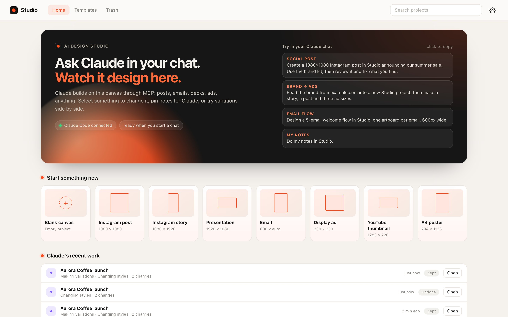</p>

---

## Made in Studio

Everything below was designed on the Studio canvas through the same tools Claude uses, then exported straight from the app.

<table>
<tr>
<td width="34%">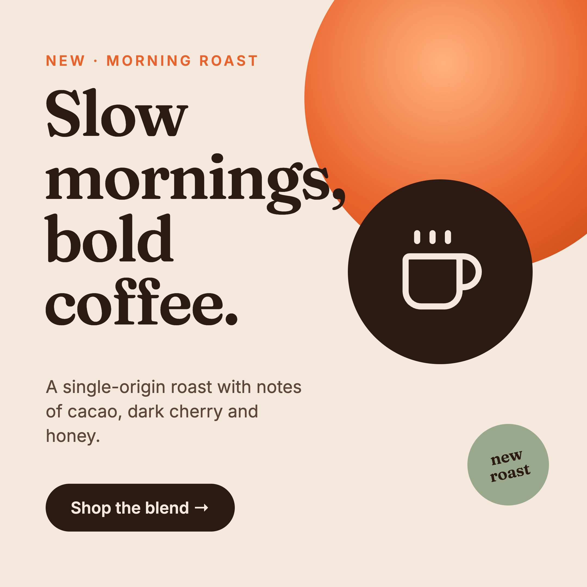</td>
<td width="19%">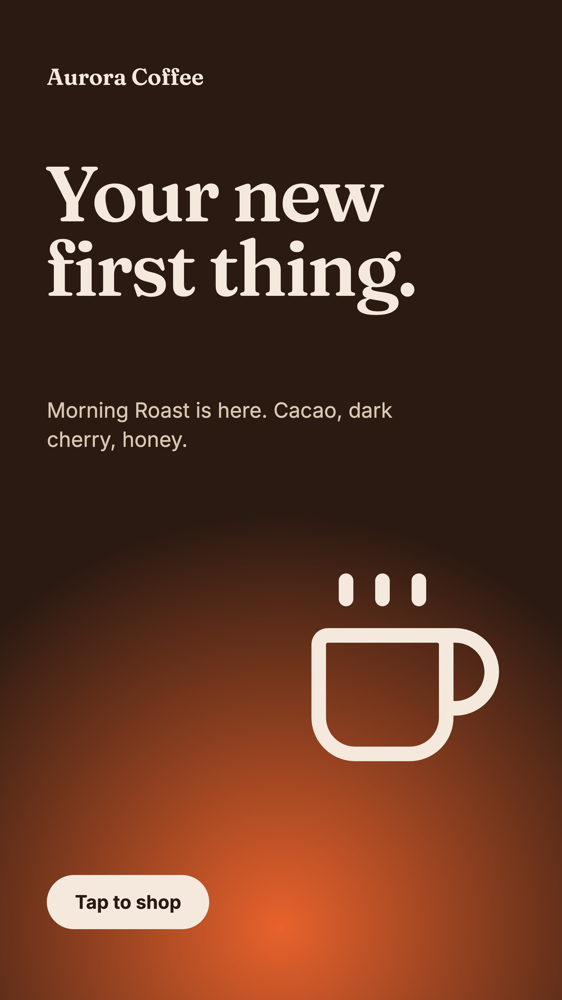</td>
<td width="21%">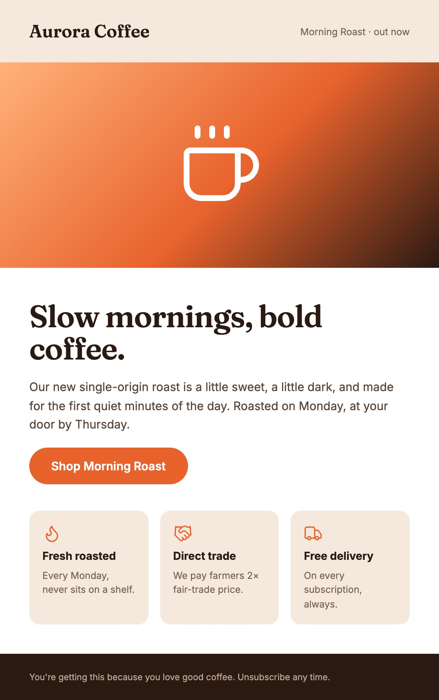</td>
<td width="26%"></td>
</tr>
<tr>
<td colspan="2">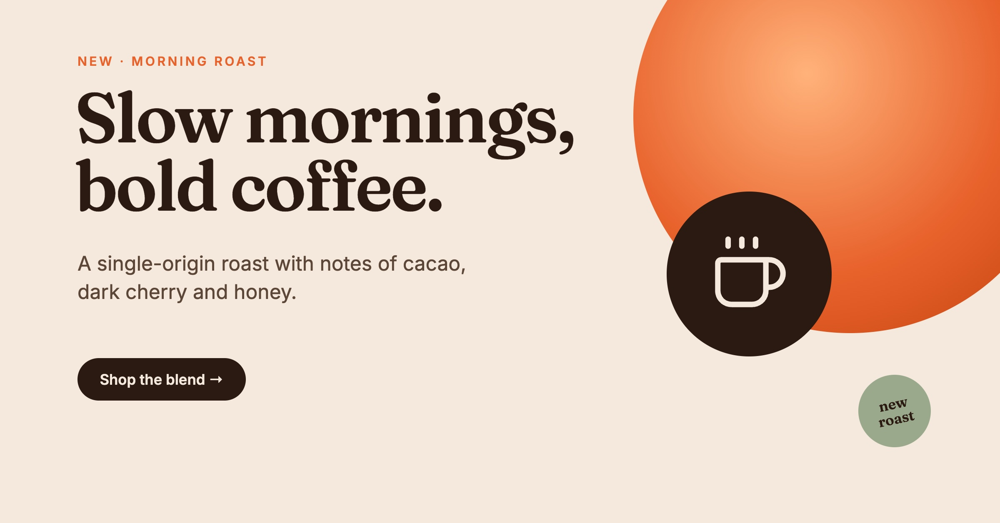</td>
<td colspan="2">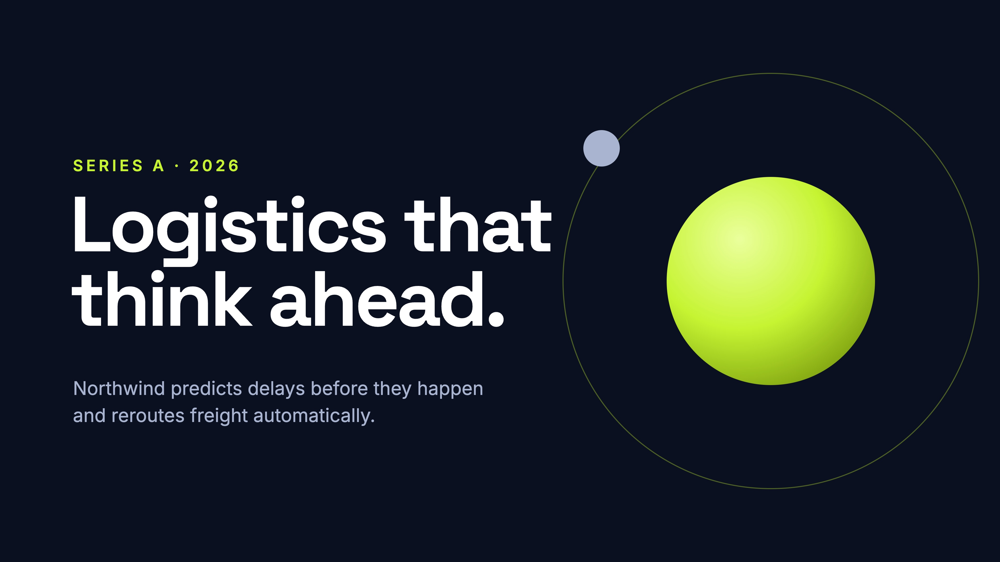</td>
</tr>
<tr>
<td colspan="2">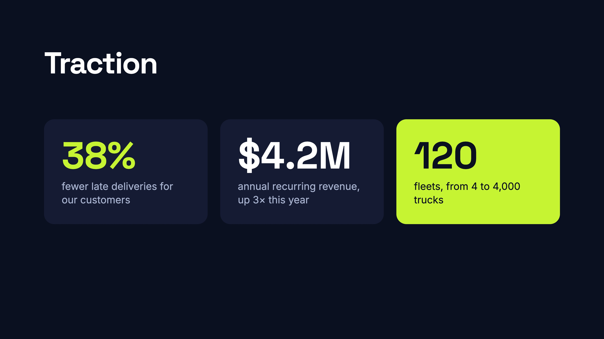</td>
<td colspan="2">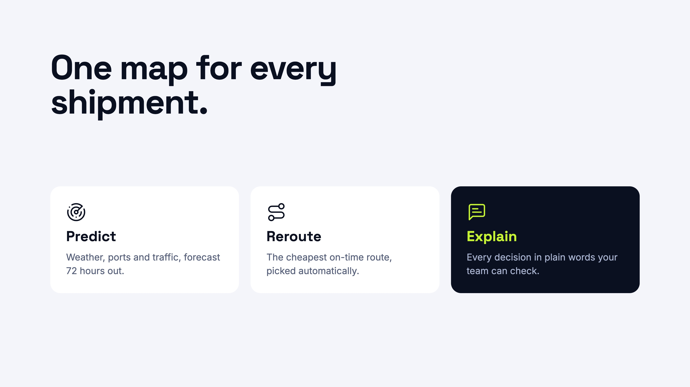</td>
</tr>
</table>

**Aurora Coffee** (a brand kit, an Instagram post, a story, a launch email and a Facebook banner resized from the post) ·
**Northwind** (a three-slide pitch deck) · **Pulse** (display ads in IAB sizes, below).

<p> </p>

---

## How it works

### 1. Ask in your Claude chat, watch it build

Studio connects to Claude Code as an MCP server. Ask for *"a 1080×1080 post announcing our summer sale"* or *"read the brand from
example.com and make a story and three ad sizes"*, and Claude builds it on the canvas while you watch. The layers it touches flash
violet, and the chip in the top bar says what it's doing.

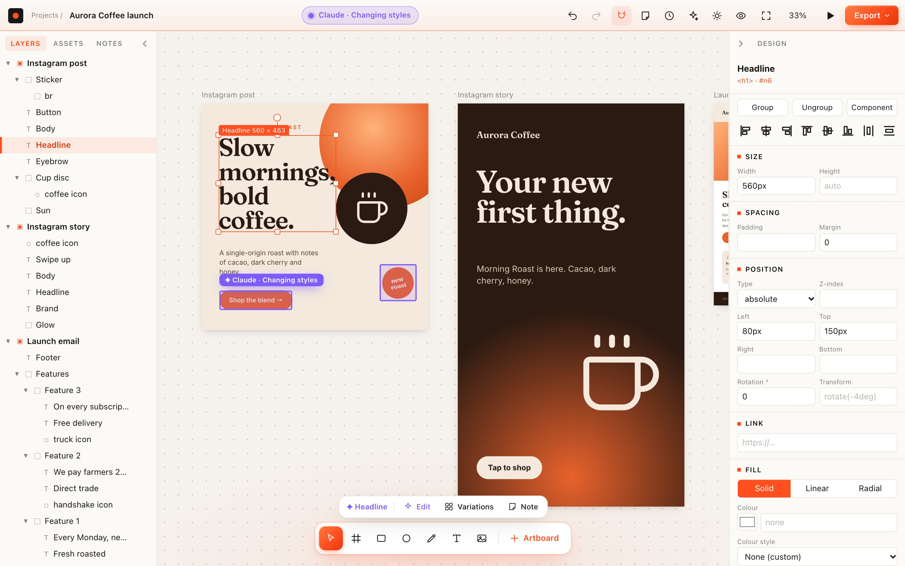

### 2. Keep or undo every run

When Claude pauses, a bar tells you how many changes it made: **Keep** them, or **Undo** to go back to how things were before it
started (one ⌘Z step). Every run saves a version first, *"Before Claude's changes"*, in History.

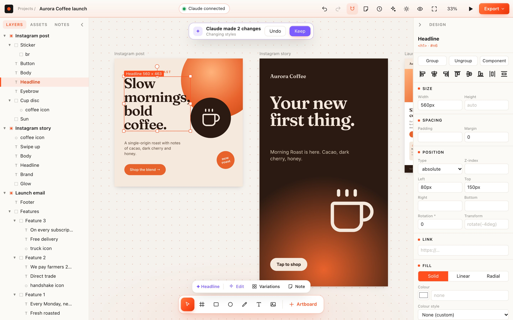

### 3. Point at things

Select something and Claude sees it, with a picture. Or press **N** to pin a note on it (*"swap the icon for a real product photo"*),
then say **"do my notes"** in the chat: Claude does each one and replies on the note. Claude leaves notes for you too, when it needs
something from you.

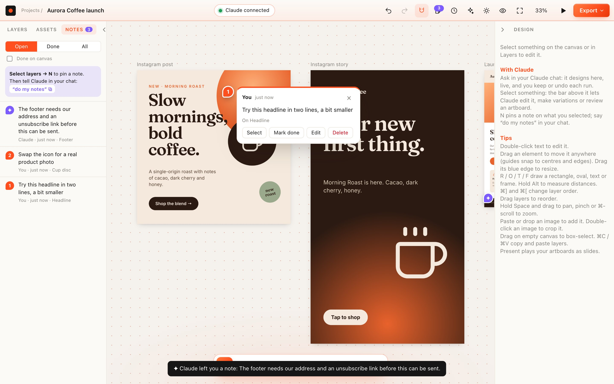

### 4. Try variations, pick one

**Variations** copies a design into a row and Claude redesigns each copy differently. *Use this* keeps one in the original's place.

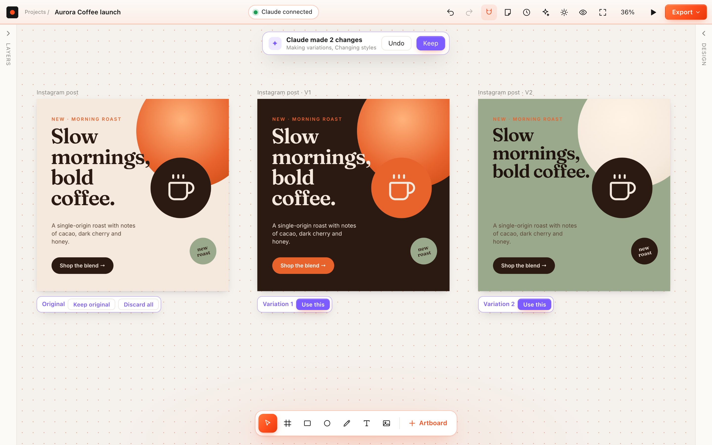

### 5. Review before you ship

**Review** renders an artboard and lists concrete problems: low contrast, text that overflows or runs off the edge, text too small for
the format, blurry or heavy images, uneven spacing, off-brand colours and fonts, missing alt text, empty links. **Ask Claude to fix**
hands the list over. Claude runs the same check (`critique`) on its own work.

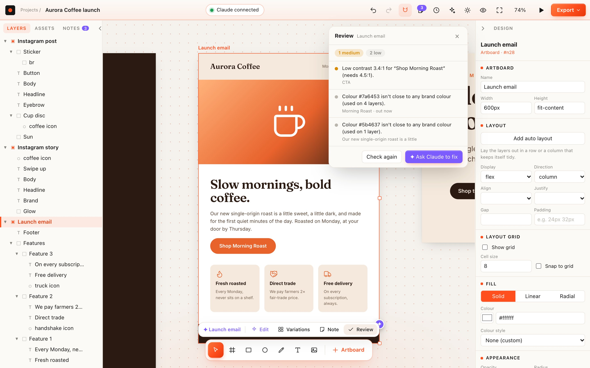

### And a real editor, in light and dark

Layers, inspector, free move with snapping, groups, components, colour and text styles, gradients, effects, crop, pen tool, rulers and
guides, auto layout, presets for every common format, version history, and exports to PNG / JPG / WebP / PDF / HTML / email.

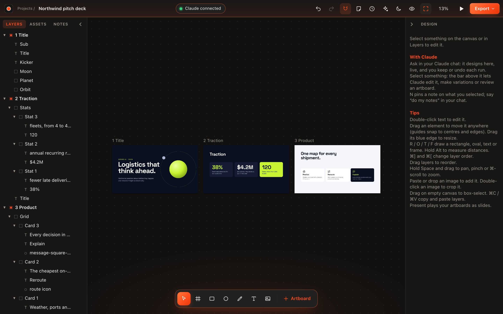

---

## Features

**Working with Claude**
- **Every app action is an MCP tool** (60+), and a test fails if one is ever missing, so Claude can do whatever you can.
- **Background work.** Claude can build in any project without switching your window; a notice offers to open it.
- **Runs of changes** with Keep / Undo and an automatic version before each one; refuses to undo over your own edits unless you confirm.
- **Live activity**: highlights on the layers Claude touches, a status chip, and a list of Claude's recent work on the home screen.
- **Notes** pinned to layers: you to Claude (`get_requests`, `resolve_request`) and Claude to you (`leave_note`).
- **Seeing its work**: screenshots of any layer, zoomed regions, before/after a run, and an automatic design critique.
- **Quick actions in the app** on your selection: Edit, Variations, Review, and Remove background / Upscale (through your Magnific connector).

**Making more, faster**
- **Resize to formats**: a post becomes a story, banners and ads as a starting point.
- **Variations** side by side; keep one.
- **Templates**: save any artboard, start new projects from it.
- **Brand from a website**: name, colours, fonts and logo into the brand kit.
- **Icons**: 1,500 Lucide line icons, offline, any size and colour.
- **Images** placed from a file or a URL (e.g. from an image generator), copied into the project.

**The canvas**
- Artboards with presets: email, Instagram post / portrait / story, TikTok, Facebook, LinkedIn, X, YouTube, Pinterest, IAB ads, slides, web, A4, Letter, posters.
- Free layout: drag anything anywhere without reflow; layers can also sit on the canvas outside any artboard (kept, not exported).
- Components with instance overrides, colour and text styles, brand kit, custom fonts, Google Fonts cached for offline use.
- Locking, links on any layer, groups, auto layout, rotation, crop, pen paths, rulers, guides, grids, measuring.
- Present mode, email preview (desktop and phone, design vs email-safe), version history, trash with restore.

**Output**
- PNG / JPG / WebP at 1–4×, PDF (one page per artboard), slices, standalone HTML with images embedded.
- **Email-safe HTML**: layouts become nested tables, buttons become bulletproof buttons; email + images zip; a `.eml` test draft.

**Looking after your work**
- Daily backups of every project to a folder you choose (iCloud or Dropbox works).
- If the Mac app runs older code than the files on disk, it offers to rebuild itself; a stale server restarts itself.

---

## Get started

**Needs:** macOS, [Node.js](https://nodejs.org) 20+, Google Chrome (for screenshots and image export), and
[Claude Code](https://claude.com/claude-code) for the AI side.

```bash
git clone https://github.com/Vikusmi/AI-Studio.git
cd AI-Studio
npm install
npm start            # http://127.0.0.1:4777
```

### Connect Claude Code

```bash
claude mcp add ai-studio -- node "$(pwd)/server/mcp.js"
```

That's it: start a Claude Code chat and ask it to design something in Studio. The MCP server starts the app server by itself, so
`npm start` is optional once Claude is connected. The home screen shows whether Claude is connected, with prompt ideas to copy.

### The Mac app

```bash
npm run make-app     # → ~/Applications/Studio.app
```

A native window (Swift + WebKit) with its own Dock icon and menu bar. Exports open a Save dialog, images a file picker. It bundles a
copy of the code and offers to rebuild when the code changes. Needs the Xcode Command Line Tools (`xcode-select --install`); without
the Swift compiler it falls back to a Chrome app window.

### Where things live

Projects are folders in `~/Library/Application Support/Studio/projects/` (`doc.json`, `assets/`, `meta.json`, `notes.json`,
`history/`); the Mac app, `npm start` and Claude share them. Templates are in `projects/.templates`, the trash in `projects/.trash`,
backups in `~/Library/Application Support/Studio/Backups` unless you pick another folder in Settings.
Environment: `STUDIO_PROJECTS=/path` (another folder), `STUDIO_PORT=4800`, `CHROME_PATH=/path/to/chrome`.

---

## MCP tools

| Group | Tools |
|---|---|
| Projects | `list_projects` `open_project` `create_project` (in the background, or from a template) `rename_project` `duplicate_project` `trash_project` `list_trash` `restore_projects` |
| Reading | `get_guide` `get_basic_info` `get_tree_summary` `get_children` `get_node_info` `get_selection` `get_screenshot` `critique` |
| Building | `create_artboard` `write_html` `update_styles` `set_attributes` `set_text_content` `set_link` `rename_nodes` `delete_nodes` `duplicate_nodes` `move_nodes` `move_layers` `reorder_nodes` `group_nodes` `ungroup_nodes` `split_text_from_box` `set_hidden` `set_locked` `set_auto_layout` `set_guides` |
| Images and icons | `place_image` `search_icons` `insert_icon` |
| More versions | `make_variations` `pick_variation` `resize_to_formats` `save_template` `list_templates` `use_template` |
| Notes | `get_requests` `resolve_request` `leave_note` |
| Brand and system | `get_brand` `set_brand` `brand_from_url` `create_style` `apply_style` `list_components` `create_component` `create_instance` `detach_instance` `list_fonts` |
| History and output | `list_versions` `save_version` `restore_version` `undo` `redo` `export` |

Every tool that works on a document takes an optional `projectId`, so Claude can work on any project without opening it.
Images can be local paths, `file://`, `https://` or `data:` URLs; they're copied into the project.

---

## Using the editor

| | |
|---|---|
| Pan / zoom | trackpad scroll, Space+drag; pinch or ⌘+scroll, ⌘+ / ⌘−, ⌘0 fits everything |
| Select | click (deepest layer), Shift-click adds, drag on empty canvas to box-select, Esc clears, Alt+↑ selects the parent |
| Tools | Move V, Frame F, Rectangle R, Oval O, Pen P, Text T, Image I, + Artboard (with presets and your templates) |
| Move | drag anything anywhere: nothing reflows, neighbours stay put, one undo puts it all back. Guides snap to edges and centres (hold ⌘ to turn off). Drop a layer outside its artboard and it stays on the canvas; drop it on another artboard to move it there |
| Quick actions | the bar above the tools works on your selection: **Edit** (⌘K), **Variations**, **Note** (N), **Review**, image **Remove BG** / **Upscale** |
| Notes | N pins a note on the selection; the Notes tab lists yours and Claude's |
| Groups | ⌘G / ⇧⌘G; double-click a group to go inside |
| Layer order | ⌘] / ⌘[ (with Shift: front / back), or drag rows in the Layers panel (front-most first, like Figma) |
| Text | double-click to edit, Enter commits, Esc cancels; inline formatting is kept |
| Images | paste or drop to add; double-click to crop; crop-to 1:1, 4:5, 16:9, 9:16; Replace… |
| Inspector | size, layout and auto layout, position and rotation, link, fill (solid / linear / radial gradients), appearance, effects, text, raw CSS |
| Assets | components, colour and text styles, fonts, brand kit (also from a website), icons |
| Right-click | layer: copy, paste, duplicate, delete, crop, replace, order, group, lock, hide, note, variations. Artboard: rename, duplicate, review, resize to formats, save as template, preview, export, present |
| Export | ⇧⌘E: PNG / JPG / WebP 1–4×, PDF, slices, HTML; email HTML, email + images zip, `.eml` test draft, copy email HTML |
| Preview | ⌥⌘E: the email on desktop and phone, as designed or email-safe |
| Versions | the clock: save named versions; automatic ones every ~10 minutes and before each Claude run; restore is undoable |
| Theme / panels | Auto / Light / Dark; drag panel edges to resize, ⌘\ hides both |

---

## How it fits together

```
server/server.js     HTTP server: editor files, live updates (SSE), POST /api/op, export, screenshots
server/doc.js        document model and operations, HTML in/out, undo, autosave
server/doc-extras.js links, locking, images, icons, resize to formats, variations, layers outside artboards
server/agent.js      Claude's runs: version first, live activity, keep / undo
server/notes.js      notes pinned to layers
server/critique.js   the design review
server/templates.js  templates; brandurl.js brand from a website; icons.js the icon library
server/upkeep.js     backups and code-version checks
server/mcp.js        the MCP server Claude talks to (wraps the HTTP API)
server/shot.js       rendering through your Chrome (puppeteer-core)
editor/              plain ES modules, no build step: home screen, editor, features/*
mac/Studio.swift     the native Mac app
```

The editor and Claude both call `POST /api/op {op, args}`: one code path, one undo history. Everything binds to 127.0.0.1.

## Tests

```bash
npm test
```

24 suites drive the real app in headless Chrome and over MCP, including `agent-test.mjs` (Claude's side: every operation has a tool,
background projects, runs, notes, critique, variations, templates, brand from a website, backups) and `studio-ui-test.mjs` (the
interface around Claude: home, selection bar with a stand-in `claude`, Keep / Undo, notes, locking, links, layers outside artboards,
review, resize, icons). Ask-Claude tests use a fake `claude` binary, so nothing is spent.

## Known limitations

- **Single user.** No multiplayer; Claude and you share one undo history per project.
- **Screenshots, PNG and PDF use Google Chrome** (headless). The Mac app itself doesn't need Chrome.
- **Undo keeps whole-document snapshots** (100 steps): fine for normal designs, heavy for huge ones.
- **Email export is a conversion, not a guarantee.** It follows email-client rules and matches the browser layout within a few
  pixels in tests, but test real sends. Images are embedded by default, which Gmail blocks: use hosted images for real sends.
- **HTML is inline-only.** `<style>`, classes and scripts are dropped on import; no hover states or media queries.
- **Google Fonts need the network the first time** a family is used; after that they come from a local cache.
- **In-app quick actions need Claude Code** installed and signed in; they use your own plan. Remove BG / Upscale also need the
  Magnific connector in your Claude account.
- **Resize to formats is a starting point.** It scales and re-places layers; a tidy-up (by you or Claude) is usually needed.
